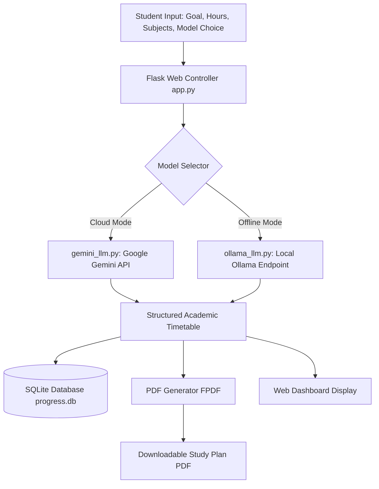

# Autonomous Student Time Management Agent (Agentic AI)

> **An intelligent, goal-driven productivity and study scheduling agent leveraging dual LLMs (Google Gemini API & Local Ollama) with SQLite task persistence.**

[](https://python.org)
[](https://flask.palletsprojects.com/)
[](https://github.com/keerthi19hub/Agentic_AI_Project)
[](https://sqlite.org)

---

## 1. Project Overview

The **Autonomous Student Time Management Agent** is an applied Agentic AI system engineered to solve one of the most common friction points in higher education: **unstructured workloads, fragmented study habits, and inefficient revision scheduling**.

Unlike static calendar apps or generic to-do lists, this application acts as an active academic planner. It accepts a student's high-level academic goal (e.g., *"Prepare for Data Science End-Sem in 14 days"*), subjects, daily available hours, and learning constraints, and autonomously reasons to synthesize an adaptive, day-by-day revision timetable.

The application features a **hybrid Dual-LLM engine**:
1. **Google Gemini API** for cloud-scale reasoning and comprehensive multi-week academic schedules.
2. **Local Ollama (Llama 3 / Mistral)** for privacy-first, zero-cost, offline timetable generation.

Generated schedules are persisted to a local **SQLite** database (`progress.db`) and can be exported as publication-ready PDF documents using **FPDF**.

---

## 2. Problem Statement

University students frequently face academic overload when balancing coursework, lab assignments, and semester exam preparation. Traditional scheduling tools fail because:
- **Lack of Adaptive Reasoning:** Manual planners require users to manually calculate study block durations and distribute topics.
- **Privacy & Connectivity Constraints:** Cloud-only AI tools require persistent internet and expose student schedules to third-party endpoints.
- **Absence of Actionable Outputs:** Generic chatbots produce unstructured text that cannot be directly printed or tracked.

This project delivers a focused agentic solution combining structured database persistence, local/cloud model switching, and automated document generation.

---

## 3. Key Features

- **Hybrid Dual-LLM Architecture:** Toggle seamlessly between **Google Gemini 1.5 / 2.0 Flash** via API and **Local Ollama** (e.g., `llama3`, `mistral`, or `qwen`) for local inference.
- **Intelligent Schedule Synthesis:** Automatically extracts timeline bounds (e.g., parses `"14 days"` via regex heuristics), computes subject-to-hour distribution, and schedules interleaved revision sessions.
- **Progress Tracking & Persistence:** Stores student profiles, active goals, allocated hours, subject lists, and generated timetables in a structured **SQLite** database.
- **Automated PDF Export:** Generates cleanly formatted, printable study schedules in PDF format via `FPDF` with unicode sanitization.
- **Responsive Web Interface:** Lightweight, distraction-free HTML5/CSS3 frontend rendered through Flask's Jinja2 template engine.

---

## 4. Technology Stack

| Component | Technology | Role |
| :--- | :--- | :--- |
| **Language** | Python 3.10+ | Core application logic and agent planning engine |
| **Web Framework** | Flask | Routing, request dispatching, and Jinja2 rendering |
| **Cloud LLM** | Google Gemini API | Cloud-based timetable reasoning and generation |
| **Local LLM** | Ollama (`llama3` / `mistral`) | Local, offline, privacy-first schedule synthesis |
| **Database** | SQLite3 (`progress.db`) | Relational persistence for student schedules and goals |
| **Document Engine** | FPDF | PDF generation and schedule export |
| **Frontend** | HTML5, CSS3, JavaScript | Interactive user interface |

---

## 5. System Architecture & Workflow



---

## 6. Repository Structure

```
Agentic_AI_Project/
├── Demo of prototype(Time management agent).mp4  # Working demonstration video
├── Keerthi.N_Pragathi.BR_Agentic AI [...].pdf     # Technical presentation and architecture slides
├── README.md                                      # Project documentation
└── Time_Management_Agent/                        # Source application directory
    ├── app.py                                     # Flask application entry point and routes
    ├── database.py                                # SQLite schema initialization and queries
    ├── gemini_llm.py                              # Google Gemini API integration
    ├── ollama_llm.py                              # Local Ollama HTTP integration
    ├── progress.db                                # SQLite database file
    ├── requirements.txt                           # Python dependencies manifest
    ├── planner/                                   # Planning heuristic modules
    ├── static/                                    # Stylesheets and frontend assets
    └── templates/                                 # Jinja2 HTML templates
```

---

## 7. Installation & Setup

### Prerequisites
- Python 3.10 or higher installed.
- (Optional for offline mode) [Ollama](https://ollama.ai) installed and running locally with `ollama run llama3`.
- (Optional for cloud mode) A Google Gemini API key from [Google AI Studio](https://aistudio.google.com/).

### Step 1: Clone the Repository
```bash
git clone https://github.com/keerthi19hub/Agentic_AI_Project.git
cd Agentic_AI_Project/Time_Management_Agent
```

### Step 2: Create a Virtual Environment
```bash
python -m venv venv
# On Windows:
venv\Scripts\activate
# On Linux/macOS:
source venv/bin/activate
```

### Step 3: Install Dependencies
```bash
pip install -r requirements.txt
```

### Step 4: Configure API Key (If using Gemini)
Set your Gemini API key as an environment variable:
```bash
# On Windows (PowerShell):
$env:GEMINI_API_KEY="your-api-key-here"

# On Linux/macOS:
export GEMINI_API_KEY="your-api-key-here"
```

### Step 5: Run the Application
```bash
python app.py
```
Open your browser and navigate to `http://127.0.0.1:5000`.

---

## 8. Usage & Workflow

1. **Enter Student Details:** Input your name, academic goal (e.g., *"Complete Python & DSA in 10 days"*), available daily hours, and target subjects.
2. **Select LLM Provider:** Choose **Gemini** for cloud synthesis or **Ollama** for local execution.
3. **Generate Plan:** The agent analyzes the inputs and constructs a daily schedule with allocated study blocks, rest breaks, and review checkpoints.
4. **Export Schedule:** Click **Download PDF** to generate an offline copy formatted for printing.
5. **Track Progress:** All past plans remain accessible in the persistent history panel.

---

## 9. Demonstrations & Project Artifacts

- **Prototype Video Demonstration:** A recorded screen demonstration is included directly in the repository as [`Demo of prototype(Time management agent).mp4`](./Demo%20of%20prototype(Time%20management%20agent).mp4).
- **Architecture Presentation:** The project research and slide deck are available as [`Keerthi.N_Pragathi.BR_Agentic AI [ Time Management Agent for Students ].pdf`](./Keerthi.N_Pragathi.BR_Agentic%20AI%20%5B%20Time%20Management%20Agent%20for%20Students%20%5D.pdf).

---

## 10. Authors & Contributions

- **Keerthi N** (*Alliance University, BCA*) — System architecture, LLM integration modules (`gemini_llm.py`, `ollama_llm.py`), Flask route engineering, database design, and documentation.
- **Pragathi BR** (*Alliance University, BCA*) — Co-developer on project research, UI template design, presentation authoring, and test case evaluation.

---

## 11. Future Roadmap

- [ ] Calendar integration (Google Calendar / iCal export sync).
- [ ] Adaptive re-planning: dynamic schedule adjustments when a user logs missed study hours.
- [ ] Task completion analytics with weekly visual burn-down charts.

---

## 12. License

This project was developed for academic and portfolio demonstration purposes at Alliance University. Released under the [MIT License](https://opensource.org/licenses/MIT).
